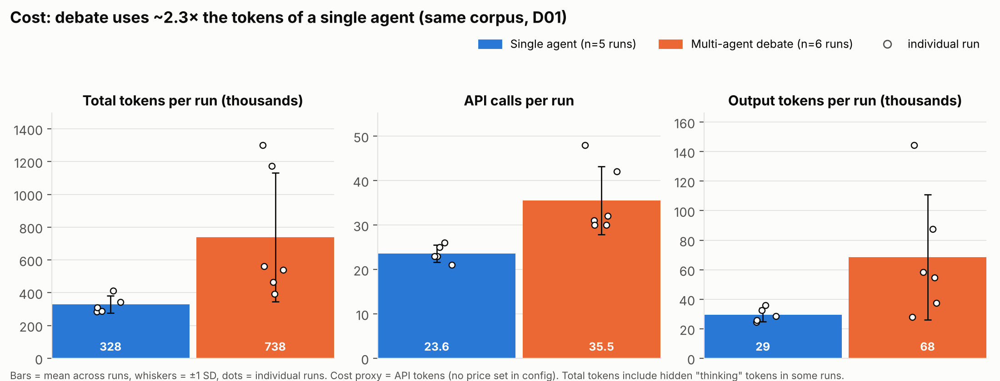
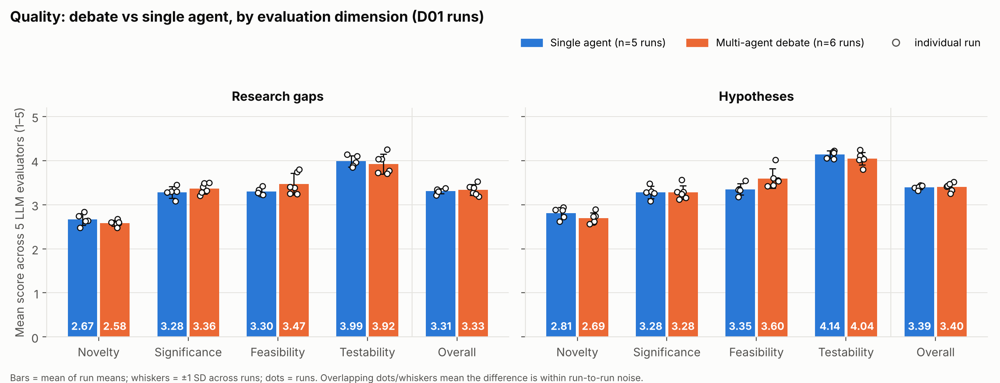
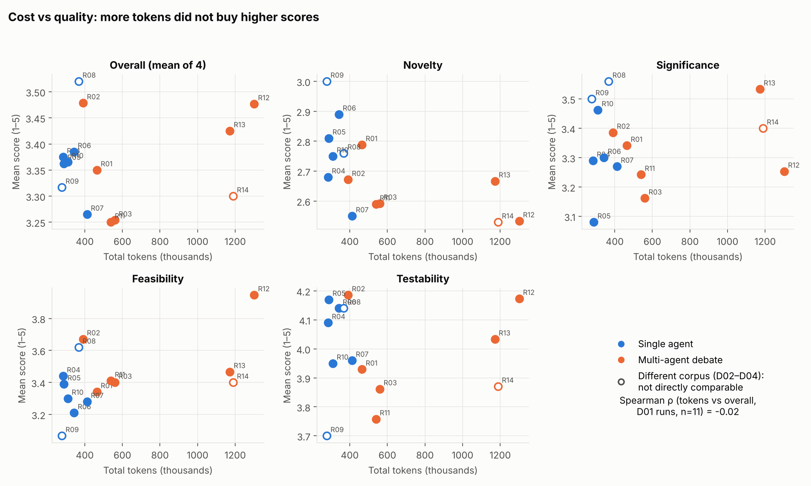

# 06 — Results

## 1. Included runs

The supplied `run_table.csv` contains 14 runs. The primary comparison uses the 11 runs on D01 (17 papers):

- **Single-agent:** R04, R05, R06, R07, R10 (5 runs)
- **Multi-agent debate:** R01, R02, R03, R11, R12, R13 (6 runs)

R08 (D02), R09 (D03), and R14 (D04) use incomplete corpus variants and are excluded from the primary comparison.

## 2. Computational cost

Values below are calculated from the supplied [`run_table.csv`](./run_table.csv), restricted to D01.

| Metric | Single-agent (n=5) | Multi-agent debate (n=6) |
|---|---:|---:|
| Mean total tokens per run | 327,650 | 738,215 |
| Mean API calls per run | 23.6 | 35.5 |
| Mean runtime per run (seconds) | 320.5 | 483.1 |

Multi-agent debate used approximately **2.25×** the total tokens of the single-agent pipeline. The cost figure rounds these means to approximately 328K and 738K and describes the ratio as about 2.3×.

### Cost figure

## 3. Quality

The supplied [`05_run_type_average_scores.csv`](./05_run_type_average_scores.csv) contains run-type average scores. The filled item-level evaluator sheet is [`05_evaluation_scores_filled.csv`](./05_evaluation_scores_filled.csv).

The supplied quality figure displays the following group means:

| Dimension | Single-agent | Multi-agent debate |
|---|---:|---:|
| Novelty | 2.81 | 2.69 |
| Significance | 3.28 | 3.28 |
| Feasibility | 3.35 | 3.60 |
| Testability | 4.14 | 4.04 |
| Overall | 3.39 | 3.40 |

On the plotted values, debate has a higher feasibility score; the single-agent pipeline has higher novelty and testability scores. Significance is equal, and the overall means are almost identical.

### Data consistency warning

The values printed on the supplied quality figure do not match the values obtained by averaging the D01 run-level scores in `run_table.csv`. Recalculation from that CSV gives:

| Dimension | Single-agent | Multi-agent debate |
|---|---:|---:|
| Novelty | 2.74 | 2.64 |
| Significance | 3.28 | 3.32 |
| Feasibility | 3.32 | 3.54 |
| Testability | 4.06 | 3.99 |
| Overall | 3.35 | 3.37 |

The discrepancy must be resolved before the manuscript adopts a definitive set of group means. The plot may have been generated from a different aggregation or data version. Regenerate the figure from the chosen authoritative CSV and explicitly document whether the aggregation is across run means or pooled item-level scores.

## 4. Token usage versus quality

The supplied cost-versus-quality figure reports a Spearman rank correlation of approximately **−0.02** between total tokens and overall quality across the 11 D01 runs. Recalculation from `run_table.csv` gives approximately −0.018.

This indicates no meaningful monotonic association between token use and overall quality in this small set of runs. It does not establish a causal relationship.

## 5. Interpretation

The current results do not show a meaningful overall quality advantage for multi-agent debate despite its higher computational cost. The clearest difference in the supplied figure is feasibility, where debate scores higher. Single-agent refinement is slightly higher on novelty and testability.

These findings are exploratory. There are only 11 comparable runs, multiple architecture snapshots, and LLM-based evaluators. The results do not establish that either architecture is universally superior.

## 6. Data files

- [`04_run_metadata.csv`](./04_run_metadata.csv) — run IDs, dataset, mode, model, parameters, calls, tokens, runtime, and item counts.
- [`05_evaluation_scores_filled.csv`](./05_evaluation_scores_filled.csv) — item-level scores from five LLM evaluators.
- [`05_run_type_average_scores.csv`](./05_run_type_average_scores.csv) — run-type average scores.
- [`run_table.csv`](./run_table.csv) — combined run-level metadata and quality summaries.

## 7. Reporting cautions

- Use D01 only for the primary single-versus-multi comparison.
- Report run counts, not only item counts.
- Distinguish architecture changes from a pure agent-count comparison.
- Reconcile the quality-figure/CSV discrepancy before final publication.
- Token usage is a computational-cost proxy; the supplied configuration does not provide monetary API prices.
